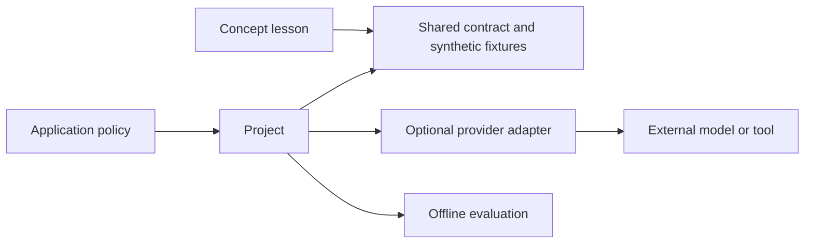

# Public repository architecture

Status: Stage 4 implementation draft, 25 November 2026. This document describes the current local tree. Stage 5 cross-platform and rights QA remain pending.

## Boundaries

```text
modules/m00-software ... m12-capstone/  stable lessons and metadata
projects/p01_llm_app ... p06_capstone/  runnable reference increments
shared/fixtures/                      invented support data
implementations/generation/           optional model adapters
implementations/embeddings/           vector teaching and optional model adapter
implementations/interoperability/mcp/ compatibility notes
assessments/                           cases and rubrics
tests/                                 offline contract checks
tools/                                 repository checks
.github/                               community templates and offline CI
```

Hyphenated module names read naturally in links; Python project directories use underscores so `python -m projects.p01_llm_app.app` works on all supported shells. This is an intentional implementation adjustment to the Stage 3 target design.



Text equivalent: lessons teach stable concepts; projects use shared contracts and fixtures. Optional adapters access external systems. Application policy controls identity, scope, validation, budgets and effects before and after external calls. Evaluation tests project behavior. External text is untrusted data.

## Module and contribution contracts

A module has a README and `module.json` with ID, title, status, prerequisites, time, offline path, project, verification date and maintainer. The validator checks structure and local links. `draft` means teaching flow and cross-platform execution still need independent review. The [module template](MODULE_TEMPLATE.md) and [contribution guide](CONTRIBUTING.md) define the authoring process. A provider addition owns its adapter, manifest or compatibility record, mocked tests and official documentation. It must not rewrite the conceptual lesson to make its API seem universal.

## Trust and operational limits

P1 validates generated output. P2 scopes retrieval by tenant before returning passages. P3 checks tool names and arguments in application code; its approval is an in-memory simulator. P4 has a host allowlist and server-side demo-only data, but no remote identity. P5's verifier cannot grant tool authority. P6 is a loopback teaching service using a shared demo token bound to a fixed demo tenant; it is not a production identity or authorization system. Its [threat model](projects/p06_capstone/THREAT_MODEL.md) lists the remaining controls.

Required offline exercises use Python 3.11+ standard library. Optional model and MCP dependencies have separate instructions. CI is configured for Linux, macOS and Windows, but the cross-platform claim requires actual successful runs in Stage 5. No live model is called in default CI.
