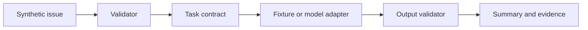
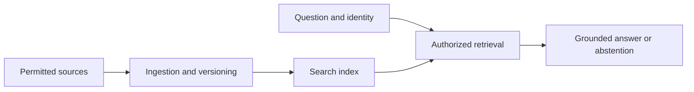
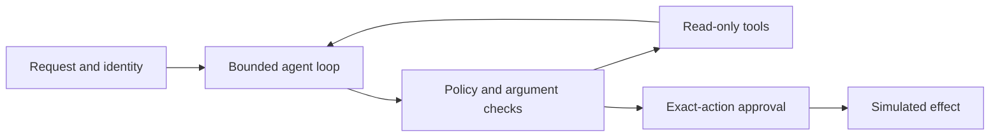
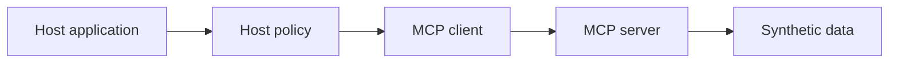
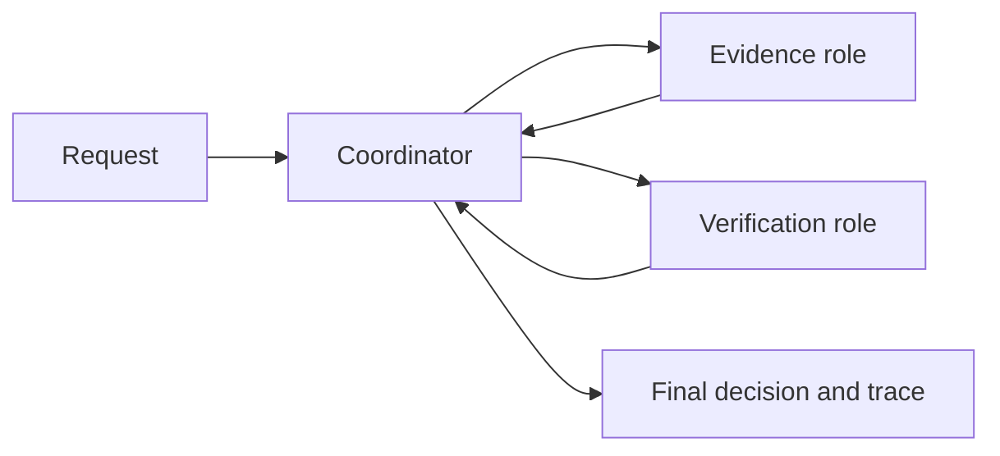
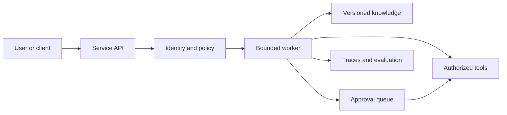

# Project progression

Use one fictional service-support domain and synthetic incidents, guides and actions throughout, or substitute another permitted domain with the same acceptance checks. Each project is a standalone portfolio milestone and a reusable increment toward P6. The six project directories contain draft reference increments. Diagrams include planned extensions beyond the current code; each project README states its actual limits.

The learner order is M00–M01 foundations → M02–M03/P1 → M04–M05/P2 → M06–M07/P3 → M08/P4 (optional SDK integration) → M09/P5 → M10–M12/P6. See the [study sequence](STUDY_SEQUENCE.md) for the exact checkpoints. At each gate, submit the artifacts named in [ASSESSMENT_FRAMEWORK.md](ASSESSMENT_FRAMEWORK.md). A deterministic reference and offline cases are required; live model paths are optional and must be labelled with tested capabilities. P4 uses an optional SDK; record an unavailable runtime without blocking M09.

## P1 — Validated LLM application

**Problem:** support staff need concise, accurate summaries of synthetic issue reports without inventing causes.

**Functional requirements:** validate an issue record; produce a summary with uncertainty and source fields; reject malformed input and unsupported claims. **Non-functional requirements:** bounded latency and output size, reproducible configuration, no secrets in logs.

Text equivalent: an input validator passes a typed task to a fixture or chosen model adapter; the application validates the returned summary before presenting it.

**Technology rationale:** Python standard library and fixtures establish the contract; a selected local or hosted adapter demonstrates live inference. ChatGPT can help explore wording, and Cursor can help implement code, but neither is the application runtime unless an explicit API integration is built. **Implementation steps:** define schema → create ten labelled cases → implement deterministic baseline → add one optional model adapter → add error/budget handling → compare results. **Alternatives:** Ollama, OpenAI API, or another documented provider; record model and endpoint separately. **Tests/evaluation:** malformed input, refusal, timeout, missing field, invented cause, task success and latency. **Security:** synthetic data, environment-based secrets, no model authority over policy. **Deployment:** documented local command; hosted deployment is an extension. **Deliverables:** code, fixtures, tests, comparison report and README. **Extension:** stream progress or add multilingual cases without changing the schema contract.

## P2 — Cited RAG application

**Problem:** users need answers grounded in a small, permitted guide collection, including a clear response when evidence is missing.

**Functional requirements:** ingest/update/delete sources; retrieve authorized passages; answer with passage-level citations or abstain. **Non-functional requirements:** repeatable index build, provenance, freshness and access boundaries.

Text equivalent: source versions feed an index; a scoped query retrieves passages; the answer cites retrieved source IDs or abstains.

**Technology rationale:** begin with lexical search and SQLite; add embeddings, vector storage, hybrid search or reranking only after a benchmark identifies a need. **Implementation steps:** source register → parser and metadata → lexical baseline → labelled retrieval set → optional embedding path → answer assembly/model path → deletion and stale-version checks. **Alternatives:** local embeddings, hosted embeddings, or lexical-only; never imply equal quality. **Tests/evaluation:** Recall@k, exact-identifier cases, hard negatives, citation support, abstention, access denial, deletion propagation. **Security:** ingest only permitted material; treat retrieved text as untrusted data. **Deployment:** local rebuild command and source refresh procedure. **Deliverables:** corpus fixtures, ingestion code, retrieval evaluation, cited answers and architecture record. **Extension:** compare a small sourced graph with a relational join.

## P3 — Controlled tool-using agent

**Problem:** an assistant should investigate an issue with read-only tools and prepare an action for human review, without acting beyond its authority.

**Functional requirements:** choose from allowlisted tools, validate arguments, record observations, stop on limits, and request exact-action approval for a simulated write. **Non-functional requirements:** auditable state, bounded calls/time, idempotent simulated effect.

Text equivalent: a bounded loop proposes a tool call; application policy validates it before any read or approval-bound simulated write.

**Technology rationale:** plain Python first so the control flow is inspectable; a model may propose calls through an adapter, but authorization stays in code. **Implementation steps:** reuse P2 evidence → define tool contracts → implement loop and terminal states → add state store → add approval record → test replay. **Alternatives:** local or hosted tool-capable model when verified; deterministic selector remains a runnable baseline. **Tests/evaluation:** unknown tool, invalid argument, no progress, timeout, denied identity, stale approval, duplicate effect, trajectory correctness. **Security:** least privilege, no shell or network tool by default, scoped identity and redacted trace. **Deployment:** local process with synthetic fixtures. **Deliverables:** code, trace examples, policy tests, approval demo and threat model. **Extension:** add a read-only external API with a contract test.

## P4 — MCP-enabled integration

**Problem:** an application needs a portable way to discover and call a synthetic external lookup while preserving host policy.

**Functional requirements:** implement a small MCP server and client; discover an allowlisted tool or resource; pass validated arguments; handle protocol, permission and transport errors. **Non-functional requirements:** documented compatibility, timeouts and audit trace.

Text equivalent: the host checks policy before its MCP client exchanges messages with a server that reads synthetic data.

**Technology rationale:** MCP demonstrates tool/resource interoperability; it does not replace identity or application authorization. **Implementation steps:** specify one read contract → implement server → implement client discovery and call → test denial and version mismatch → record tested SDK/spec versions. **Alternatives:** a direct HTTP adapter remains the comparison baseline; hosted/remote MCP is optional. **Tests/evaluation:** successful exchange, malformed arguments, unavailable server, denied tool, version/capability mismatch. **Security:** no credentials in tool descriptions; validate both host and server boundaries. **Deployment:** local stdio path first; remote server is an extension. **Deliverables:** client/server, compatibility record, trace, tests and README. **Extension:** resource subscription or remote authorization only after official capability verification.

## P5 — Multi-agent workflow comparison

**Problem:** a complex request may benefit from separate evidence gathering and answer review, but coordination may add errors and latency.

**Functional requirements:** implement two specialized roles, a coordinator, disagreement handling and a single-agent baseline. **Non-functional requirements:** bounded messages, reproducible state and per-role cost/latency accounting.

Text equivalent: a coordinator asks two bounded roles for evidence and verification, then records a decision and unresolved disagreement.

**Technology rationale:** a plain workflow is the baseline; graph orchestration or A2A may be evaluated only where roles cross a genuine system boundary. **Implementation steps:** freeze cases → implement baseline → add roles → define shared-context contract → handle disagreement and role failure → compare. **Alternatives:** single agent, deterministic workflow, graph library or separately versioned agent protocol. **Tests/evaluation:** task success, unsupported agreement, repeated work, failure recovery, latency, cost and trace clarity. **Security:** separate permissions by role; untrusted role output cannot grant authority. **Deployment:** local single process; distributed roles are an extension. **Deliverables:** both implementations, comparison report and keep/remove decision. **Extension:** test a protocol-based remote role with the same cases.

## P6 — Production-grade agentic application

**Problem:** a team needs a support investigation service that can be released, measured, recovered and operated with clear human responsibility.

**Functional requirements:** combine validated intake, versioned retrieval, bounded tool use, approval, task status, identity and audit; expose a documented service interface. **Non-functional requirements:** reproducible release, availability target, latency and cost budgets, data isolation, rollback and retention.

Text equivalent: an API validates identity and policy, a bounded worker uses versioned knowledge and authorized tools, and approval plus observability are explicit services.

**Technology rationale:** start with a local service, SQLite and a documented process supervisor; add containers, queue, cloud or distributed inference only for a measured requirement. **Implementation steps:** freeze requirements and holdout cases → integrate P1–P5 components → add identity boundary and task state → instrument traces → package release → run failure, rollback and handover drills. **Alternatives:** local model, hosted provider or hybrid; direct adapters or MCP; single-agent design may replace P5 if comparison favors it. **Tests/evaluation:** end-to-end task and trajectory quality, citation support, tenant denial, injection resistance, duplicate-effect prevention, p50/p95 latency where meaningful, cost per successful task, recovery time and rollback. **Security:** threat model, least privilege, secret handling, data retention, dependency review and human approval for side effects. **Deployment:** local process required; container/cloud recipes are optional verified paths. **Deliverables:** source, docs, fixtures, tests, evaluation report, architecture decision records, release manifest, runbook, threat model and demo. **Extension:** load test, multilingual evaluation or an additional provider adapter.

## Exit rule

P6 is a portfolio demonstration on synthetic or explicitly permitted data. It must not be labelled production-ready solely because the local tests pass. A real deployment needs environment-specific security, legal, reliability and user acceptance review.
