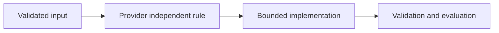

# M05 — Retrieval and grounded answers

Status: draft teaching module. Estimated time: 18 hours. Prerequisites: M04, M01. Required: Python 3.11+, Git and an ordinary laptop. Optional: a provider or coding assistant where linked. Offline API cost: zero; live usage varies by provider and model. No GPU is needed for the offline path.

## Problem and objectives

The practical question is how to apply **lexical and vector search, citation support and abstention** to the synthetic support workflow. By completion, explain the concept, run the reference, change one behavior, test a failure case, and defend the trade-off.

## Concept and architecture

Read the [concept guide](CONCEPTS.md) before modifying the reference implementation.

Lexical and vector search, citation support and abstention. Keep model or tool proposals distinct from application policy. Identity, source scope, output validation and effect approval belong to the application. A saved response or toy vector demonstrates an interface; it does not prove model quality.

Text equivalent: validated input passes through a stable rule and bounded implementation; evaluation checks the result. External content is untrusted at the implementation boundary.

## Guided demonstration

From the repository root, run `python -m unittest discover -s tests -p "test_*.py" -v`. On macOS or Linux, `python3` may replace `python`; on Windows, use `py -3` if necessary. See the [project guide](../../projects/p02_rag/README.md) for the relevant command and expected result. The demonstration is deterministic and uses invented fixtures.

## Guided exercise

Run P2 lexical retrieval cases and calculate Recall@2 with its denominator. Start from the project code, write a failing test first, then make the smallest change that passes it. Record the command, test result and one limitation.

## Independent challenge

Add a hard negative; compare the toy vector baseline without claiming semantic quality. Explain the invariant before reading the reference solution. Submit a short result with the input, expected result, observed result and a failure case.

## Project integration and assessment

Integrate the result into [P02_RAG](../../projects/p02_rag/README.md). Completion requires a working change, a normal and a negative test, a measured or counted result with denominator where relevant, and an explanation of one design choice. Use the [assessment framework](../../ASSESSMENT_FRAMEWORK.md). A passing reference suite alone is not learner completion.

## Alternatives and limits

The fixture path is required. [Generation adapters](../../implementations/generation/README.md) and [embedding adapters](../../implementations/embeddings/README.md) are optional where relevant. ChatGPT or Cursor can assist development, but they are not interchangeable with a runtime API. Local inference requires a suitable model and hardware; hosted inference may incur cost. Compatibility must be tested per model and version.

## Common mistakes and troubleshooting

- If imports fail, run from the repository root.
- If a live call fails, return to the fixture path and check opt-in, model name, service availability and provider requirements.
- If a test passes but the claim is broad, add a negative case and state the untested boundary.

## Knowledge check and reading

Explain the data boundary, predict one failure, implement and test the challenge, then compare one alternative. Further reading: [Python documentation](https://docs.python.org/3/), [MCP specification](https://modelcontextprotocol.io/specification/2026-07-28) for integration topics, and the official provider links in the [technology register](../../TECHNOLOGY_REGISTER.md). Links and example APIs were reviewed on 25 November 2026; this module's end-to-end teaching flow is not yet independently verified.
