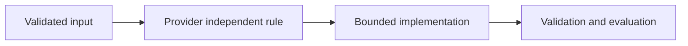

# M07 — State, memory and human control

Status: draft teaching module. Estimated time: 14 hours. Prerequisites: M06. Required: Python 3.11+, Git and an ordinary laptop. Optional: a provider or coding assistant where linked. Offline API cost: zero; live usage varies by provider and model. No GPU is needed for the offline path.

## Study checkpoint

Prerequisite: M06. Practice: P3 exact-action simulated approval and replay. Continue when you can show a mismatched approval denial and idempotent repeat; then M08 or M09. Previous: [M06](../m06-tools/README.md); next: [M08](../m08-mcp/README.md). See the [study sequence](../../STUDY_SEQUENCE.md).

## Problem and objectives

The practical question is how to apply **checkpoints, exact-action approval and idempotency** to the synthetic support workflow. By completion, explain the concept, run the reference, change one behavior, test a failure case, and defend the trade-off.

## Concept and architecture

Read the [concept guide](CONCEPTS.md) before modifying the reference implementation.

Checkpoints, exact-action approval and idempotency. Keep model or tool proposals distinct from application policy. Identity, source scope, output validation and effect approval belong to the application. A saved response or toy vector demonstrates an interface; it does not prove model quality.

Text equivalent: validated input passes through a stable rule and bounded implementation; evaluation checks the result. External content is untrusted at the implementation boundary.

## Guided demonstration

From the root run the P3 tests with `python -m unittest discover -s tests -p "test_*.py" -v`. Trace the approval fields and replay key in `projects/p03_tool_agent/app.py`. The default reference approval is in memory; run `python -m projects.p03_tool_agent.durable_demo` for the optional SQLite-backed simulated approval and effect. On macOS/Linux, `python3` may replace `python`; on Windows, use `py -3` if necessary.

## Guided exercise

Run the P3 simulated alert acknowledgment twice using the same approval and key. Start from the project code, write a failing test first, then make the smallest change that passes it. Record the command, test result and one limitation.

## Independent challenge

Demonstrate rejection of a cross-tenant or mismatched target approval. Explain the invariant before reading the reference solution. Submit a short result with the input, expected result, observed result and a failure case.

## Project integration and assessment

Integrate the result into [P03_TOOL_AGENT](../../projects/p03_tool_agent/README.md). Completion requires a working change, a normal and a negative test, a measured or counted result with denominator where relevant, and an explanation of one design choice. Use the [assessment framework](../../ASSESSMENT_FRAMEWORK.md). A passing reference suite alone is not learner completion.

## Alternatives and limits

The fixture path is required. [Generation adapters](../../implementations/generation/README.md) and [embedding adapters](../../implementations/embeddings/README.md) are optional where relevant. ChatGPT or Cursor can assist development, but they are not interchangeable with a runtime API. Local inference requires a suitable model and hardware; hosted inference may incur cost. Compatibility must be tested per model and version.

## Common mistakes and troubleshooting

- If imports fail, run from the repository root.
- If a live call fails, return to the fixture path and check opt-in, model name, service availability and provider requirements.
- If a test passes but the claim is broad, add a negative case and state the untested boundary.

## Knowledge check and reading

Explain the data boundary, predict one failure, implement and test the challenge, then compare one alternative. Further reading: [Python documentation](https://docs.python.org/3/), [MCP specification](https://modelcontextprotocol.io/specification/2026-07-28) for integration topics, and the official provider links in the [technology register](../../TECHNOLOGY_REGISTER.md). Links and example APIs were reviewed on 25 November 2026; this module's end-to-end teaching flow is not yet independently verified.
