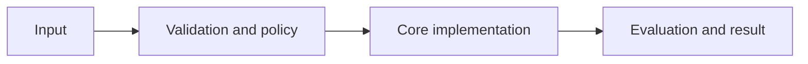

# Validated issue summary

## Place in the study sequence

Enter after M02–M03. Complete the project evidence and independent challenge, then continue to P2 after M04–M05. See the [study sequence](../../STUDY_SEQUENCE.md) and [project progression](../../PROJECT_PROGRESSION.md). The reference implementation is a starting point, not evidence that the full project gate has been met.

## Problem and requirements

Summarize an invented incident without inventing a cause. Validate issue fields and output identity, source, length and uncertainty. This reference is a learning artifact using invented data. Keep requests bounded, dependencies explicit, and secrets out of fixtures and logs.

## Architecture

Text equivalent: input is checked by application policy before the core implementation runs; its result is validated and evaluated. Specific flow: shared.core → generator adapter → output validator.

## Technology and alternatives

Python 3.11+ and standard library provide the offline baseline. Fixture baseline is free; OpenAI Responses or local Ollama generation is opt-in and model-specific. See the [technology register](../../TECHNOLOGY_REGISTER.md) for official sources, verification and limitations. Provider availability and pricing vary; no live call runs in default tests.

## Implementation and local run

1. From the repository root, inspect `shared/fixtures/` and the project `app.py`.
2. Run `python -m unittest discover -s tests -p "test_*.py" -v` from the root.
3. Run `python -m projects.p01_llm_app.app` from the root. On macOS/Linux, `python3` may be needed; on Windows use `py -3` if `python` is unavailable.
4. Change one behavior, add a negative test, and rerun the suite.
5. Record the fixture, code and provider versions used in a comparison report.

For a live optional path, install the chosen provider separately, set `LEARN_AI_PROVIDER` to `openai` or `ollama`, set `ALLOW_LIVE_MODEL=1`, and set `OPENAI_MODEL` or `OLLAMA_MODEL`. Use only the synthetic fixture. The OpenAI path also needs the provider SDK and API credentials in the process environment; the Ollama path needs a running local service and model. Live results are unverified and may fail validation.

Run `python -m projects.p01_llm_app.evaluate` from the root for ten labelled synthetic cases. The fixture baseline passes 10/10 automatic checks. The report marks nonliteral generated summaries for human support review; a source ID or valid JSON does not prove a claim is true. See the [local model verification](../../LIVE_VERIFICATION.md) for observed failures.

## Testing and evaluation

Malformed issue, wrong source, empty uncertainty and live opt-in denial. Use [project rubric](../../assessments/rubrics/project_rubric.md). Report numerators and denominators for measured metrics. The reference tests check selected invariants; they do not establish model quality or learner competence.

## Security and operations

All fixture content is synthetic. Source text and model output are untrusted. The host application owns identity, tenant scope, tool permissions, limits and effect approval. The local demonstration is not an internet-facing deployment. For P6, see its [threat model](../p06_capstone/THREAT_MODEL.md) and [runbook](../p06_capstone/RUNBOOK.md).

Output schema checks cannot establish that a generated sentence is factually supported. Review model outputs against source text and record unsupported-claim cases.

## Deliverables and extension

Submit code, fixture comparison, failure table and one changed prompt. **Challenge:** Compare two prompt versions on the same labelled cases.
