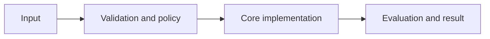

# Cited retrieval application

## Problem and requirements

Answer from permitted synthetic runbooks and abstain when evidence is absent. Version, update and delete documents; enforce tenant scope; cite exact passage IDs. This reference is a learning artifact using invented data. Keep requests bounded, dependencies explicit, and secrets out of fixtures and logs.

## Architecture

Text equivalent: input is checked by application policy before the core implementation runs; its result is validated and evaluated. Specific flow: Source versions → lexical index → scoped retrieval → cited answer.

## Technology and alternatives

Python 3.11+ and standard library provide the offline baseline. Lexical baseline is required; toy vectors teach similarity but are not semantic embeddings. Ollama embeddings are optional. See the [technology register](../../TECHNOLOGY_REGISTER.md) for official sources, verification and limitations. Provider availability and pricing vary; no live call runs in default tests.

## Implementation and local run

1. From the repository root, inspect `shared/fixtures/` and the project `app.py`.
2. Run `python -m unittest discover -s tests -p "test_*.py" -v` from the root.
3. Run `python -m projects.p02_rag.app` from the root. On macOS/Linux, `python3` may be needed; on Windows use `py -3` if `python` is unavailable.
4. Change one behavior, add a negative test, and rerun the suite.
5. Record the fixture, code and provider versions used in a comparison report.

## Testing and evaluation

Tenant isolation, stale version, deletion, abstention and Recall@2 denominator. Use [project rubric](../../assessments/rubrics/project_rubric.md). Report numerators and denominators for measured metrics. The reference tests check selected invariants; they do not establish model quality or learner competence.

## Security and operations

All fixture content is synthetic. Source text and model output are untrusted. The host application owns identity, tenant scope, tool permissions, limits and effect approval. The local demonstration is not an internet-facing deployment. For P6, see its [threat model](../p06_capstone/THREAT_MODEL.md) and [runbook](../p06_capstone/RUNBOOK.md).

The current answer path is extractive and the vector path is a comparison exercise; generated answer synthesis is not implemented.

## Deliverables and extension

Submit corpus, retrieval report, citations and failure analysis. **Challenge:** Add a hard negative and compare an actual embedding model if available.
