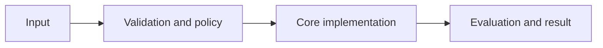

# Controlled tool agent

## Place in the study sequence

Enter after M06–M07. Complete the project evidence and independent challenge, then continue to P4 after M08, or P5 after M09 if SDK unavailable. See the [study sequence](../../STUDY_SEQUENCE.md) and [project progression](../../PROJECT_PROGRESSION.md). The reference implementation is a starting point, not evidence that the full project gate has been met.

## Problem and requirements

Investigate a synthetic issue with bounded read-only search and one simulated effect. Allowlist proposals, validate arguments, stop at max steps, bind approval to exact tenant/action/target/key. This reference is a learning artifact using invented data. Keep requests bounded, dependencies explicit, and secrets out of fixtures and logs.

## Architecture

Text equivalent: input is checked by application policy before the core implementation runs; its result is validated and evaluated. Specific flow: Proposal → host policy → scoped tool → observation; approval → simulated effect.

## Technology and alternatives

Python 3.11+ and standard library provide the offline baseline. Deterministic selector is the baseline; model tool proposals remain a future optional adapter. See the [technology register](../../TECHNOLOGY_REGISTER.md) for official sources, verification and limitations. Provider availability and pricing vary; no live call runs in default tests.

## Implementation and local run

1. From the repository root, inspect `shared/fixtures/` and the project `app.py`.
2. Run `python -m unittest discover -s tests -p "test_*.py" -v` from the root.
3. Run `python -m projects.p03_tool_agent.app` from the root. On macOS/Linux, `python3` may be needed; on Windows use `py -3` if `python` is unavailable.
4. Change one behavior, add a negative test, and rerun the suite.
5. Record the fixture, code and provider versions used in a comparison report.

## Testing and evaluation

Unknown tool, malformed argument, exhausted budget, cross-tenant approval and replay. Use [project rubric](../../assessments/rubrics/project_rubric.md). Report numerators and denominators for measured metrics. The reference tests check selected invariants; they do not establish model quality or learner competence.

## Security and operations

All fixture content is synthetic. Source text and model output are untrusted. The host application owns identity, tenant scope, tool permissions, limits and effect approval. The local demonstration is not an internet-facing deployment. For P6, see its [threat model](../p06_capstone/THREAT_MODEL.md) and [runbook](../p06_capstone/RUNBOOK.md).

## Deliverables and extension

Submit trajectory, denial trace, approval demonstration and threat model. **Challenge:** Replace simulated approval with a durable authenticated mechanism in an isolated design.
