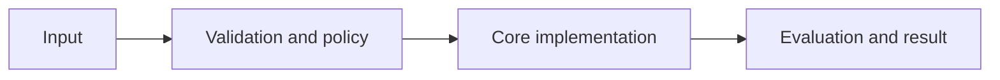

# Two-role workflow comparison

## Place in the study sequence

Enter after M09 after P3; M08 runtime optional. Complete the project evidence and independent challenge, then continue to P6 after M10–M12. See the [study sequence](../../STUDY_SEQUENCE.md) and [project progression](../../PROJECT_PROGRESSION.md). The reference implementation is a starting point, not evidence that the full project gate has been met.

## Problem and requirements

Test whether separate evidence and verification roles improve a synthetic support answer. Compare to one-role baseline; verifier disagreement blocks assertion. This reference is a learning artifact using invented data. Keep requests bounded, dependencies explicit, and secrets out of fixtures and logs.

## Architecture

Text equivalent: input is checked by application policy before the core implementation runs; its result is validated and evaluated. Specific flow: Question → evidence role → verification role → decision.

## Technology and alternatives

Python 3.11+ and standard library provide the offline baseline. Plain Python workflow first; graph frameworks and A2A are optional experiments. See the [technology register](../../TECHNOLOGY_REGISTER.md) for official sources, verification and limitations. Provider availability and pricing vary; no live call runs in default tests.

## Implementation and local run

1. From the repository root, inspect `shared/fixtures/` and the project `app.py`.
2. Run `python -m unittest discover -s tests -p "test_*.py" -v` from the root.
3. Run `python -m projects.p05_multi_agent.app` from the root. On macOS/Linux, `python3` may be needed; on Windows use `py -3` if `python` is unavailable.
4. Change one behavior, add a negative test, and rerun the suite.
5. Record the fixture, code and provider versions used in a comparison report.

Run `python -m projects.p05_multi_agent.evaluate` from the root for a case-matched, repeated offline comparison. It reports case passes, role steps and median local wall time. Both paths have zero API spend; the tiny synthetic set and machine-specific timing do not establish model-provider cost or broad superiority.

## Testing and evaluation

Verified, disputed and abstained cases; compare steps and latency. Use [project rubric](../../assessments/rubrics/project_rubric.md). Report numerators and denominators for measured metrics. The reference tests check selected invariants; they do not establish model quality or learner competence.

## Security and operations

All fixture content is synthetic. Source text and model output are untrusted. The host application owns identity, tenant scope, tool permissions, limits and effect approval. The local demonstration is not an internet-facing deployment. For P6, see its [threat model](../p06_capstone/THREAT_MODEL.md) and [runbook](../p06_capstone/RUNBOOK.md).

## Deliverables and extension

Submit both baselines, case-level comparison and keep/remove decision. **Challenge:** Add verifier failure and state recovery.
